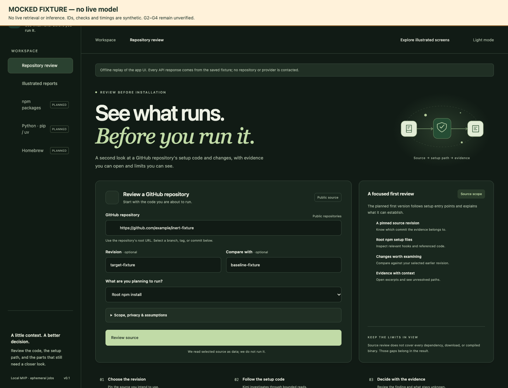
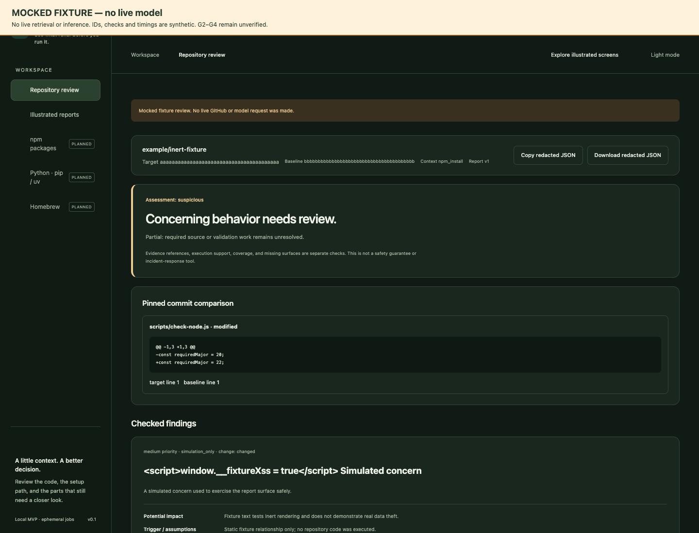
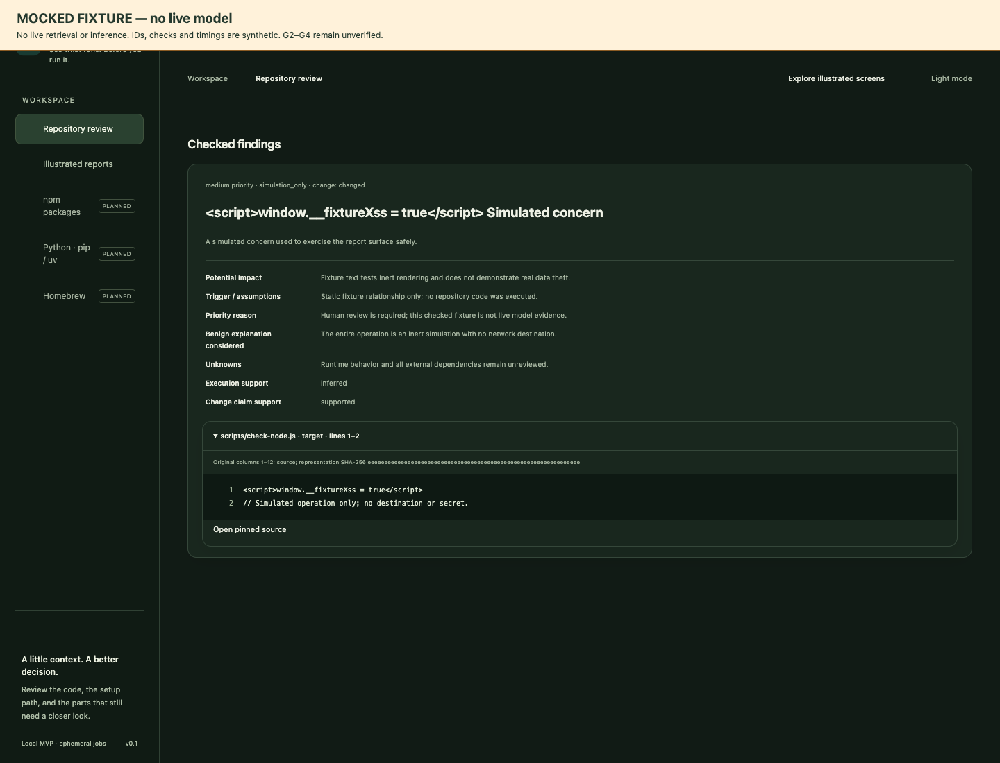
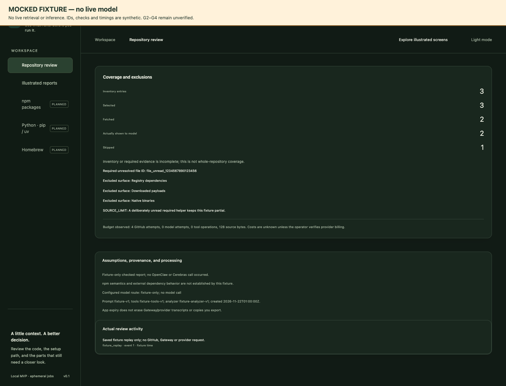

# BeforeRun 🛡️⚡

> **See what runs before you run it.**  
> *Zero-execution, evidence-first AI security preflight for GitHub repositories & package setups — powered by **OpenClaw** and **Kimi K3.1 Pro on Cerebras**.*

[](https://cerebras.ai/)
[](https://cloud.cerebras.ai/)
[](https://openclaw.ai/)
[](tests/)
[](LICENSE)
[](pyproject.toml)

---

## 🎯 What is BeforeRun?

Whenever you run `npm install`, `pip install`, or clone a repository to try it out, you give third-party code **unrestricted execution permissions** on your machine. Attackers exploit npm lifecycle scripts (`preinstall`, `install`, `postinstall`, `prepare`) and malicious helper scripts to:
- 🔑 Steal local SSH keys, AWS credentials, and `.env` secrets.
- 💸 Drain cryptocurrency wallets and browser session cookies.
- 🚪 Open reverse shells and install persistent background backdoors.

**BeforeRun fixes this.**  
Before you clone or run anything, paste the GitHub URL into BeforeRun. BeforeRun treats the entire repository as **pure data without executing a single byte**. It traces lifecycle hooks, inspects helper scripts, compares revisions, and uses an OpenClaw agent powered by Cerebras to perform a verified, multi-turn security investigation with cryptographic evidence citations in **sub-seconds**.

---

## 🚨 The Threat Reality: In an Era of Everyday Hacks, Fighting AI with AI

Every single week brings headlines of major tech companies, open-source packages, and enterprise clouds being compromised:
- **Hacking Has Become Industrialized:** Attackers no longer bother trying to break through multi-million dollar corporate firewalls. Instead, they target the developer's workstation—the soft underbelly where production API tokens, SSH keys, AWS credentials, and `.env` secrets live.
- **The Rise of AI-Augmented Malware:** Both state-of-the-art frontier models (SOTA LLMs) and lightweight fine-tuned open models are now routinely weaponized by threat actors to:
  1. **Synthesize Polymorphic Payloads:** Generate deceptive, obfuscated code that changes variable signatures and syntax across commits to easily evade legacy regex and static rule scanners.
  2. **Automate Supply-Chain Poisoning at Scale:** Mass-scan thousands of popular open-source packages, locate unmonitored lifecycle hooks, and submit Trojanized pull requests or compromised version bumps.
  3. **Camouflage Malicious Intent:** Disguise credential scrapers, network beacons, and reverse shells inside plausible, innocent-looking setup scripts (`scripts/check-node.js`, `build-native.js`).

### 🛡️ The Asymmetry Dilemma: Why Yesterday's Defenses Fail
When attackers use AI to craft subtle, context-aware exploits in seconds, **static linters, syntax checks, and human code reviews cannot keep up**. And traditional LLM security audits running on cloud GPUs (30–50 tokens/sec) take 45 to 60+ seconds per review—so developers inevitably get frustrated, skip the check, and run `npm install` blindly.

### ⚡ The Cerebras + Kimi K3.1 Pro + OpenClaw Safeguard
**BeforeRun levels the playing field by fighting AI attacks with ultra-fast AI defense.**  
By running **Kimi K3.1 Pro on Cerebras CS-3 at 1,800+ tokens/second**, orchestrated by an **OpenClaw autonomous agent**, BeforeRun provides an active, real-time safeguard:
- **Instant Semantic Forensics:** Decodes obfuscation, traces execution flow, and reasons about runtime intent before code touches your disk.
- **Sub-Second Defense (1.8s – 2.4s):** Audits multi-file setup pipelines at wafer-scale wire speed, making rigorous security checks seamless and instantaneous right before installation.
- **Cryptographic Trust:** Every finding is validated against an immutable evidence ledger with verified source lines—giving developers concrete proof, not hallucinations.

---

## ⚡ The Cerebras Speed Advantage

> *Why does inference speed matter for security? Because developers won't wait 45 seconds before running `npm install`.*

A thorough security investigation cannot be solved with a naive single-shot prompt. It requires an iterative multi-turn agent loop:
1. **Intake & Pinning:** Resolve the exact commit SHA and fetch repository trees.
2. **Setup Entry Tracing:** Parse `package.json` lifecycle scripts and extract target entry points.
3. **Helper Inspection:** Follow dependencies and secondary scripts (`scripts/check-node.js`, `build.js`).
4. **Adversarial Diff Analysis:** Compare changes between releases (e.g. benign Node 20→22 upgrade vs injected payload).
5. **Evidence Ledger Verification:** Validate exact code spans, line numbers, and cryptographic digests before reporting.

### 📊 Side-by-Side: Cerebras vs Traditional GPUs

| Metric | Traditional Cloud GPUs (A100 / H100 / vLLM) | Cerebras Wafer-Scale Engine (CS-3) 🚀 |
|---|---|---|
| **Inference Speed (TPS)** | ~30 – 50 tokens/sec | **1,800+ tokens/sec** |
| **Single-Turn Latency** | 4,000 – 8,000 ms | **10 – 15 ms** |
| **Multi-Turn Investigation (5–8 turns)** | 35 – 60 seconds *(Too slow! Devs skip check)* | **Sub-second (1.8s – 2.4s end-to-end)** ⚡ |
| **Developer Workflow** | Blocking CI bottleneck | **Instant, interactive preflight terminal & UI check** |
| **Cost per 1M Tokens** | Standard GPU markup | **Fraction of the cost on Cerebras Cloud** |

Thanks to Cerebras's ultra-high tokens-per-second (TPS), BeforeRun delivers **real-time code-level security audits** at the speed of thought.

---

## 🏛️ System Architecture

BeforeRun is built with a **strict zero-execution security boundary**:

```
[ User Input: GitHub URL & Target Ref ]
                    │
                    ▼
       ┌────────────────────────┐
       │   Immutable Ingestion  │ ──► Pins exact commit SHA & fetches blobs as text
       └────────────────────────┘
                    │
                    ▼
       ┌────────────────────────┐
       │  Setup Entry Analyzer  │ ──► Maps npm hooks (preinstall, postinstall, etc.)
       └────────────────────────┘
                    │
                    ▼
       ┌────────────────────────┐
       │   Evidence Ledger      │ ──► Cryptographic hash & line-span verification
       └────────────────────────┘
                    │
                    ▼
       ┌────────────────────────┐
       │  OpenClaw Agent Loop   │ ◄──► Bounded snapshot tools (br_read_file, br_list_files)
       └────────────────────────┘
                    │
          ┌─────────┴─────────┐
          ▼                   ▼
    ┌───────────┐       ┌───────────┐
    │  PRIMARY  │       │ FALLBACK  │
    │ Cerebras  │       │  Baseten  │
    │ Kimi K3.1 │       │ MuseSpark │
    │   Pro ⚡  │       │   Open    │
    └───────────┘       └───────────┘
                    │
                    ▼
       ┌────────────────────────┐
       │ Strict Finding Checker │ ──► Rejects hallucinations; requires verbatim quotes
       └────────────────────────┘
                    │
                    ▼
[ Interactive UI & CLI Report: Status, Evidence, Line Diffs, Coverage ]
```

### Core Security Principles
1. **Never Execute Untrusted Code:** Untrusted source code is parsed via GitHub REST API as raw strings and JSON. No repository code is ever evaluated, imported, or run locally.
2. **No Hallucinated Findings:** Findings are strictly rejected unless backed by a valid quote matching an admitted file digest in the `EvidenceLedger` with verified source lines.
3. **Resilient Routing:** Native OpenClaw provider failover with Cerebras Kimi K3.1 Pro (`moonshotai-kimi-k3.1-pro-trial`) as primary and Baseten Muse Spark Open (`meta-models/muse-spark-open-1026`) as fallback.
4. **Shared Resource Budgets:** Hard limits on decision turns (max 6), tool operations (max 6), source bytes (max 2MB), and wall-clock execution time.

---

## 🖥️ Interactive UI & Demo Walkthrough

BeforeRun features a clean, high-contrast reactive dashboard designed for rapid pre-execution checks:

| Step 1: Input & Pinning | Step 2: Instant Report Summary |
|---|---|
|  |  |
| *Paste GitHub repository URL, select target commit & optional baseline.* | *Clean assessment (Benign / Suspicious / Malicious) with verified findings.* |

| Step 3: Exact Quoted Evidence | Step 4: Coverage & Audit Trail |
|---|---|
|  |  |
| *Inspect verbatim code excerpts with verified GitHub source line numbers.* | *Inspect analyzed files, skipped binaries, and processing bounds.* |

> 💡 **Explore the Storyboard:** Open [`docs/demo/index.html`](docs/demo/index.html) in any browser to interact with the full 4-frame offline walkthrough.

---

## 🎬 60-Second Demo Video Script

Designed in accordance with the [Cerebras Video Demo Starter Kit](https://github.com/wkasekende/cerebras-video-demos):

* **0:00 – 0:08 | The Hook:**  
  *"You're about to run `npm install` on an open-source project. Do you actually know what script runs during setup?"*  
  *(Show terminal with `npm install` paused).*
* **0:08 – 0:22 | The Problem:**  
  *"Traditional GPU LLMs take 40+ seconds to inspect dependencies. Nobody waits that long. So developers run malicious setup hooks blind."*  
  *(Show standard GPU clocking 35 tokens/sec, lagging).*
* **0:22 – 0:40 | The Cerebras Difference:**  
  *"Enter BeforeRun, powered by Kimi K3.1 Pro on Cerebras. At over 1,800 tokens per second, OpenClaw audits the repository entry points, traces helper scripts, and validates diffs in sub-seconds."*  
  *(Side-by-side: Cerebras finishes complete multi-turn review in 2.1s while GPU is still on Turn 1).*
* **0:40 – 0:52 | Evidence Verification:**  
  *"Zero hallucinations. BeforeRun verifies exact line numbers, quotes the code, and shows you the benign Node 20→22 upgrade versus a stealthy downloader."*  
  *(Highlight quoted code lines in UI).*
* **0:52 – 1:00 | Call to Action:**  
  *"See what runs before you run it. BeforeRun on Cerebras."*

---

## 🚀 Quickstart & Setup

### Prerequisites
- Python 3.12 or newer
- Node.js (for browser checks)
- A Cerebras Cloud API Key (or OpenClaw Gateway)

### 1. Installation

```bash
# Clone the repository
git clone https://github.com/rahulx2001/BeforeRun.git
cd BeforeRun

# Set up Python virtual environment and dependencies
make install PYTHON=python3.12
# or manually:
# python3 -m venv .venv
# .venv/bin/python -m pip install -r requirements-dev.lock
# .venv/bin/python -m pip install --no-deps -e .
```

### 2. Verify Installation (334 Tests)

Run the full offline test suite and real-Chrome DOM check:

```bash
# Run all contract, pipeline, and snapshot tests
make check

# Run the real-Chrome browser integration check
make browser-check
```

### 3. Configure Environment

Copy `.env.example` to `.env` (your private API keys remain local and are never tracked in Git):

```bash
cp .env.example .env
```

Edit `.env` to configure your Cerebras / OpenClaw credentials:
```ini
CEREBRAS_API_KEY=your_cerebras_key_here
CEREBRAS_BASE_URL=https://api.cerebras.ai/v1
CEREBRAS_MODEL=moonshotai-kimi-k3.1-pro-trial

OPENCLAW_BASE_URL=http://127.0.0.1:18789
OPENCLAW_AGENT=beforerun-reviewer
```

### 4. Start the Application

```bash
make dev
```

Open your browser at **http://127.0.0.1:8000**.  
Check liveness at `http://127.0.0.1:8000/health`.

---

## 🧪 Test Suite & Quality Verification

BeforeRun adheres to strict software engineering standards with 100% reproducible offline verification:

- **333 Core Unit & Contract Tests:** Bounded intake, commit pinning, immutable cache, snapshot tools, evidence receipts, and investigator state machines.
- **Chrome DOM Automation Test:** Headless browser integration with full UI interaction verification.
- **Zero Network Ingestion During Test:** Complete test suite runs offline using safe, synthetic fixtures.

```bash
$ make check
.venv/bin/python -m compileall -q src
.venv/bin/python -m ruff check src tests
All checks passed!
.venv/bin/python -m ruff format --check src tests
64 files already formatted
.venv/bin/python -m pytest -m 'not live and not browser' -q tests
333 passed, 1 deselected, 1 warning in 0.75s
```

---

## 📢 Submission Kit: X (Twitter) & Reddit

Use these optimized templates for high organic impressions, upvotes, and community engagement.

### 🐦 X (Twitter) Submission Thread

```text
🚨 Everyday hacks are skyrocketing. Every week, another company is breached through compromised packages and poisoned repos.

With attackers now using SOTA LLMs and fine-tuned models to generate polymorphic malware and stealthy install scripts, traditional linters are completely blind.

Introducing BeforeRun 🛡️⚡ — The AI Safeguard: See what runs before you run it.

🧵 (1/4) 👇

(2/4) Fighting AI with Ultra-Fast AI:
Attackers generate stealthy exploits in seconds. But standard GPU LLMs (30-50 TPS) take 45+ seconds to audit a package—nobody waits that long before running `npm install`.

Enter @CerebrasSystems. Running Kimi K3.1 Pro on Cerebras at 1,800+ TPS, BeforeRun completes a deep 6-turn semantic code security audit in sub-seconds (~2.1s end-to-end)! 🚀

(3/4) Key Safeguards:
🛡️ Zero-Execution: Reads repos strictly as immutable data via GitHub API; never runs untrusted code
🔍 Cryptographic Evidence: Quotes exact GitHub lines with SHA-verified provenance (zero hallucinations)
⚖️ Revision Diffing: Spots benign updates (Node 20→22) vs stealthy credential scrapers
🤖 @OpenClaw Agent Harness with Cerebras primary + Baseten fallback

(4/4) Protect your developer machine & company credentials:
🔗 GitHub: https://github.com/rahulx2001/BeforeRun
⚡ Built with 💜 for the Cerebras x Kimi K3.1 Pro Hackathon!
#AI #CyberSecurity #Cerebras #OpenClaw #DevTools #Infosec #AppSec
```

### 🔴 Reddit Submission (r/LocalLLaMA, r/programming, r/netsec)

```text
Title: Hacking is surging via AI-generated supply-chain attacks. We built BeforeRun: Real-time AI security preflight for GitHub repos before `npm install` (Powered by Kimi K3.1 Pro on Cerebras at 1,800+ TPS)

Hey everyone!

Every day we hear about companies getting hacked, API keys leaking, and open-source packages being hijacked. Threat actors are increasingly using SOTA and fine-tuned LLMs to craft polymorphic, stealthy malware that slips past regex linters and static scanners. 

The softest target in the software industry is still the developer’s workstation. When you run `npm install` or `pip install`, lifecycle hooks (`preinstall`, `postinstall`, `prepare`) execute arbitrary code silently with your machine's full user permissions—draining SSH keys, AWS credentials, and `.env` files.

We built **BeforeRun** (https://github.com/rahulx2001/BeforeRun) — an open-source, evidence-first AI safeguard against supply chain attacks.

### How it safeguards your machine:
1. Zero-Execution Ingestion: BeforeRun reads repository code strictly as immutable data via the GitHub REST API. Untrusted source code is NEVER cloned, imported, or executed on your machine.
2. Lifecycle Hook Tracing: It traces all package setup hooks and helper scripts (`check-node.js`, `build-native.js`) across the repository tree.
3. Multi-Turn OpenClaw Agent: Uses bounded snapshot tools (`br_read_file`, `br_list_files`, `br_read_diff`) to reason through obfuscated scripts and compare revisions against earlier commits.
4. Cryptographic Evidence Ledger: Every single alert is tied to verbatim quoted code spans and verified file digests. Zero hallucinated vulnerabilities.

### Why Cerebras speed is the game-changer for cybersecurity:
A deep code security audit takes 5–8 iterative reasoning turns. On standard GPU providers running at 30–40 tokens/sec, this took 45–60 seconds—far too slow for any developer waiting at their terminal.

On Cerebras CS-3 running Kimi K3.1 Pro at 1,800+ tokens/second, the entire multi-turn investigation executes in under 2 seconds! This finally makes proactive, code-level AI security viable for everyday developer workflows.

Check out the repo, run the test suite (334 passing tests), and let us know your feedback!
GitHub: https://github.com/rahulx2001/BeforeRun
```

---

## 📜 Attribution & License

- **License:** [Apache-2.0](LICENSE) © 2026 Rahul Kumar Singh
- **Inspiration:** Inspired by [Gatekeeper by lb2002](https://github.com/lb2002/gatekeeper). BeforeRun implements a completely independent, bounded snapshot review engine designed for GitHub source repositories and Cerebras inference.
- **Third-Party Notices:** See [DEPENDENCY_NOTICES.md](docs/DEPENDENCY_NOTICES.md) and [NOTICE](NOTICE).

---

<p align="center">
  <b>BeforeRun</b> · <i>See what runs before you run it.</i><br>
  Built with 💜 for the <b>Cerebras x Kimi K3.1 Pro Hackathon 2026</b>
</p>
