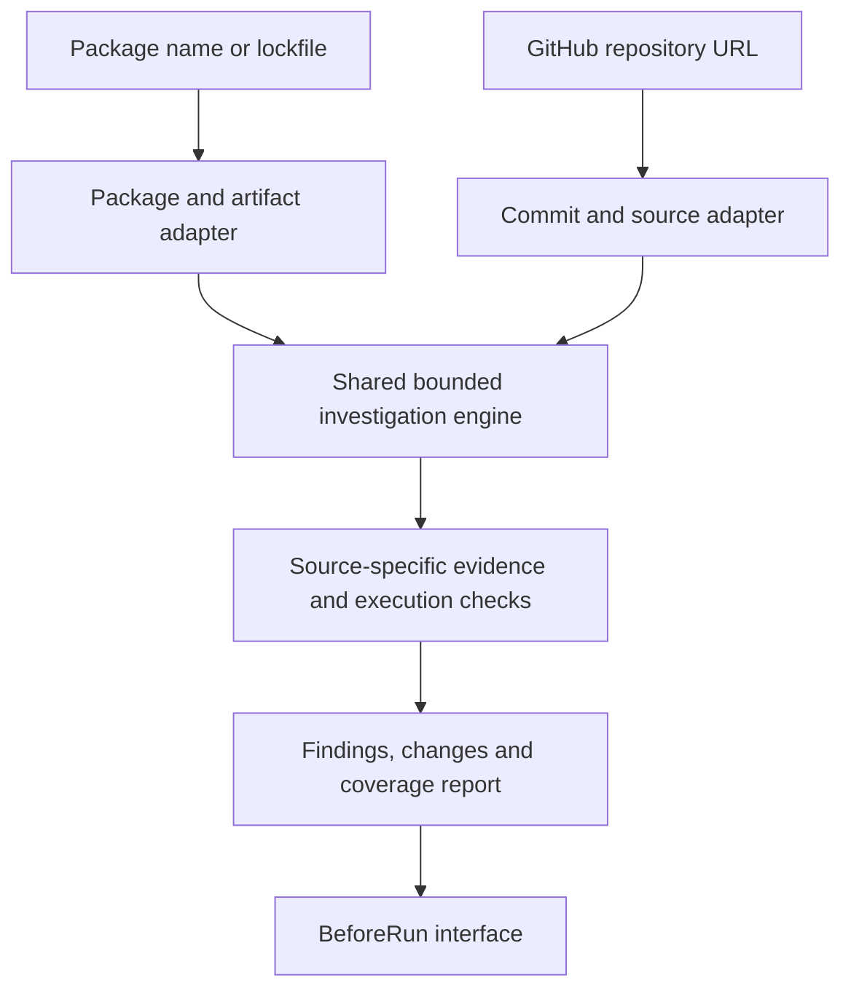

# BeforeRun product scope: Gatekeeper-style protection plus repository review

> **Background scope record.** The authoritative combined design, task sequence, and
> full roadmap are now in [MASTER_BUILD_PLAN.md](MASTER_BUILD_PLAN.md). Preserve this
> document's historical scope clarification; follow the master where details differ.

**Clarified on 15 November 2026. Planning only; no scanner implementation.**

The user's intended product is a Gatekeeper-inspired package/dependency investigator
**with an additional paste-a-GitHub-repository workflow**. Package investigation remains
part of that product. The earlier choice of GitHub review first sets the order of the
hackathon work; it does not replace the overall product with a repository-only tool.

## What is correct about the existing blueprint

The [research brief](RESEARCH_BRIEF.md) and [technical design](TECHNICAL_DESIGN.md) give a
reasonable design for the repository addition: pin the source revision, inspect setup
entry points and helpers without executing them, optionally compare a selected revision,
let Kimi investigate through bounded reads, and validate the displayed evidence.

Those documents are specifications. They do not demonstrate detection accuracy, latency,
full Gatekeeper feature parity, or a working scanner. The application currently serves a
static interface and a health endpoint. Model access, evaluation cases, and detection
quality still need implementation and measurement during the event.

The earlier blueprint concentrated on the GitHub-first event milestone. It should always
be read alongside the broader two-input product described here. Python being conditional
in that milestone is a scope recommendation, not a claim that Python repositories or
`setup.py` attacks are outside the intended product.

## What Gatekeeper already supplies, according to the reviewed sources

This review used Gatekeeper's public README and the relevant `main` source pages served
on 15 November 2026. These are read-only source observations, not an executed benchmark,
an exhaustive audit, or a verified exact-head checkout. The previous research separately
records revision `072210e91b19e3174d4afecefe1464acb0ca2c25`.

| Capability | Evidence in the reviewed project | BeforeRun implication |
|---|---|---|
| Package investigation | The README and investigator describe a tool-using model reviewing package files. | Retain this product concept and make Kimi central to the event implementation. |
| Checked code references | The validation layer checks findings against source lines and relevant evidence. | Reuse the principle; actual BeforeRun checks must still be implemented. |
| Package comparisons | The comparison layer constructs release/fork-package evidence. | Repository commit comparison needs separate source identity and diff handling. |
| Lockfile audit | The audit path processes dependency records and coordinates package investigation. | Retain project/dependency audit in the roadmap; one root-source review does not provide it. |
| Browser input | The inspected try page offers package and lockfile investigation. | Add repository URL, target commit/ref, optional baseline, and setup-command context. |
| Install guard | The documented guard supports a bounded npm command scope and explicitly describes limitations for Git sources and project-root installs. | A report alone is not an install guard; guard support needs separate implementation. |

The repository-review addition is more specific than “GitHub support.” Gatekeeper already
has a GitHub Action and can investigate some URL-sourced dependency archives. Its reviewed
archive reader handles npm tarballs. These features do not establish a browser workflow that
reviews an arbitrary repository's own root setup path at a pinned source commit.

Conversely, the absence of that workflow in the inspected UI/code does not prove that no
branch, fork, or future release offers it. Avoid claiming global novelty or that Gatekeeper
has no GitHub-related functionality.

## Intended architecture

The shared engine supplies investigation state, safe read/search tools, Kimi calls,
budgets, evidence IDs, and report rendering. Each adapter supplies the source identity,
retrieval rules, entry-point semantics, comparison baseline, and coverage limits.

| Input | Identity to record | What it can establish |
|---|---|---|
| Published package | Registry, exact release, selected artifact and digest | Findings about that artifact within the supported package context. |
| Lockfile | Exact dependency records, sources, resolved artifacts and inspected subset | Findings about the dependencies actually resolved and reviewed. |
| GitHub repository | Repository, full commit, optional baseline and selected setup command | Findings about the inspected root source/setup path and relevant helpers. |

Keep the identities separate even though the model/report workflow is shared. A clean
source review does not establish that a published artifact matches it. Finding a known
package does not establish that a local checkout has the same code. Dependency discovery
from a repository's manifest is not completed dependency investigation.

BeforeRun can eventually offer both modes in the same interface. GitHub-first means the
repository adapter is the first enabled route; the package adapter remains a planned
capability. Do not display an inactive package input as functional support.

## Milestones and parity

1. **Event milestone:** shared investigation/evidence foundation plus the GitHub source
   adapter. Required Node setup scope; Python only after its dedicated cases pass.
2. **Next product input:** npm package/artifact investigation using the same engine,
   with exact identity, bounded retrieval, lifecycle checks, and package-specific tests.
3. **Dependency workflow:** lockfile audit, dependency paths, unresolved-source handling,
   and explicit inspected/unknown coverage.
4. **Additional protection workflows:** separately scoped PR/CI integration, install guard,
   and monitoring. Evaluate each before claiming it works.
5. **Further ecosystem coverage:** Python source/artifact support, then other package
   ecosystems according to the validated roadmap.

This sequence preserves the user's product direction without asserting that Gatekeeper's
entire feature set plus a new adapter fits a 24-hour event. If both package and repository
inputs must be delivered during the event, that is a larger acceptance target and requires
an explicit schedule revision. The current schedule promises only the repository milestone.

“Inspired by Gatekeeper” does not mean that BeforeRun inherits its working features,
model configuration, performance measurements, or detection claims. The reviewed code
also contains provider-specific and optional classifier functionality. Changing providers
is not sufficient by itself to establish equivalent behavior.

## Expected value and limits for the compromised-repository scenario

The proposed workflow could warn a developer when an inspected setup path collects
sensitive data, downloads and runs another program, or invokes a changed suspicious helper.
Show the supporting chain and code before making a claim about installation behavior.
The npm and Python references in [the source register](RESEARCH_SOURCES.md) explain why
setup/build steps warrant this investigation.

Ordinary source retrieval is different from invoking setup or application code. The
review is intended to happen before the relevant command. It cannot stop the original
account compromise, guarantee that all malware is detected, certify unread dependencies
or remote payloads, or remediate an already infected machine. A suspicious change also
does not by itself identify an attacker or establish that the account was hacked.

## Implementation and reuse boundary

The user explicitly requested research only before the hackathon. Keep this stage to
planning. Reimplementing selected concepts during the event and extending an existing
codebase are different choices; the current workspace contains no copied Gatekeeper core.

The [recorded event rules](HACKATHON_RULES.md) require core functionality developed during
the event. Gatekeeper's license and accurate attribution remain relevant if material is
reused, but a software license does not determine competition eligibility. Do not claim
that changing the UI or model makes an imported completed product an original event build.
See [the attribution draft](ATTRIBUTION_DRAFT.md) for release work.

## Sources inspected for this clarification

- [Gatekeeper README](https://github.com/lb2002/gatekeeper/blob/main/README.md)
- [Investigator](https://github.com/lb2002/gatekeeper/blob/main/src/gatekeeper/investigate.py)
- [Evidence validation](https://github.com/lb2002/gatekeeper/blob/main/src/gatekeeper/models/validate.py)
- [Package comparison](https://github.com/lb2002/gatekeeper/blob/main/src/gatekeeper/evidence/compare.py)
- [Dependency audit](https://github.com/lb2002/gatekeeper/blob/main/src/gatekeeper/audit.py)
- [Browser input](https://github.com/lb2002/gatekeeper/blob/main/src/gatekeeper/report/try_page.py)
- [Guard scope](https://github.com/lb2002/gatekeeper/blob/main/docs/guard-threat-model.md)
- [Package archive reader](https://github.com/lb2002/gatekeeper/blob/main/src/gatekeeper/npm/tarball.py)

Read through the corresponding raw-source pages. These links track `main`, so they can
change; pin the revision actually used if code is reused or a benchmark is conducted.
