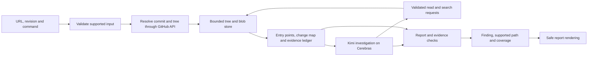

# BeforeRun technical design for event-time implementation

> **Historical specification — superseded for implementation.** Use
> [MASTER_BUILD_PLAN.md](MASTER_BUILD_PLAN.md) for the combined contracts, limits,
> profile-scoped OpenClaw integration, namespaced snapshot tools, and result policy.
> This document remains research/background, not a competing setup guide.

**15 November 2026 — specification only.** No routes, retriever, detector, model client,
functional fixtures, or investigation tests have been implemented by this research.
The recommendations refine [RESEARCH_BRIEF.md](RESEARCH_BRIEF.md). Source IDs refer to
[RESEARCH_SOURCES.md](RESEARCH_SOURCES.md).

The full product combines package/dependency investigation with repository review.
This document specifies the GitHub-first event adapter and shared investigation
foundation. The [product scope](PRODUCT_SCOPE.md) shows the planned package adapter;
its artifact identity and lifecycle checks must remain distinct from commit identity.

## 1. System boundary and data flow

The proposed service reviews a bounded public GitHub source snapshot. Repository source,
filenames, metadata, and model responses are untrusted. The retrieval worker has narrowly
scoped outbound access; the investigator's tools can only read the current snapshot.
Neither the model nor source files can grant capabilities.

This is one backend, one investigation loop, and the existing interface. Start with the
current FastAPI scaffold and an HTTP client during the event. A queue service, vector
database, browser automation stack, and multiple investigator agents are unnecessary
for the controlled first demo. Use a per-review task and bounded concurrency.

## 2. Input contract

| Field | Initial behavior |
|---|---|
| Repository URL | A public `https://github.com/owner/repository` root URL. A trailing slash or `.git` may be normalized. |
| Target ref | Optional branch, tag, or commit; default branch if absent. Resolve once. |
| Baseline ref | Optional ref in the same repository. Absent means snapshot review, not an automatically guessed clean baseline. |
| Command context | `review_only` or supported `npm_install` in the required demo. Enable `pip_install_project` only if its adapter passes the Python gate. |
| Project directory | Repository root only for the event. Detect nested manifests and report the scope gap. |
| Manager/environment context | Record the supported npm semantics and assumed script settings. Report `.npmrc` or shell behavior that cannot be resolved. |

Reject unsupported hosts, custom ports, embedded credentials, local paths, SSH URLs,
query-string fetch targets, and arbitrary API base URLs. Return an explanatory message
for a `/tree/...` or file URL; do not guess where a slash-containing branch name ends.
Set independent length limits. Parse and encode refs as API parameters; never interpolate
them into a shell command or use them as filesystem paths.

Keep command choice as an enum in the event product. Free-text commands require a larger
parser/semantic contract and must not become executable input. Review-only mode can
identify behavior in source but must not invent the command that reaches it.

## 3. Retrieval and immutable identity

Recommended sequence:

1. Construct a repository-metadata request to the fixed GitHub API host. Confirm that
   the repository is public even if the backend token could access private repositories.
   Record the canonical identity and repository ID. Handle renamed repositories through
   a checked redirect/canonicalization policy, not arbitrary redirect following.
2. Resolve target and, when supplied, baseline to full commit IDs. Record each commit's
   tree identity. After resolution, use those identities for every fetch and link.
3. Request a bounded tree listing. Inspect ordinary file modes, executable file modes,
   symlinks, submodules, and directory entries. Respect provider truncation and local
   response/file-count limits; a partial tree stays partial.
4. Select root manifests, relevant configuration, and direct setup entry files. Read
   ordinary file blobs by IDs from the pinned tree. Permit the investigator to request
   further approved files only within the same snapshot and budget.
5. Cache immutable content by repository identity and object ID. Recheck current access
   policy at intake; caching is not a way to evade public/private policy. Keep report
   caches separate and include command context, refs, model/settings, and analyzer versions.
6. Record exact bytes, an application content digest, Git object identity, encoding,
   line boundaries, and provenance before generating excerpts. Preserve original line
   numbering even if a display normalizes line endings.

GitHub documents tree truncation, comparison-file limits, and contents-endpoint symlink
handling. Use trees/blobs for this workflow. A valid GitHub response is still subject to
our smaller budgets. [S22](RESEARCH_SOURCES.md#s22)–[S27](RESEARCH_SOURCES.md#s27).

Do not clone or check out a repository, recurse into submodules, resolve LFS content,
execute filters, download release assets, follow README URLs, or invoke package-manager
metadata generation during this review. Git blobs are read as data; executable mode
alone neither causes execution nor proves maliciousness.

Avoid GitHub's comparison endpoint as the only source of changed paths: its file list
is capped. Instead, compare the path/object/mode maps for the two snapshots. Classify
added, removed, modified, and mode-changed entries within the fetched scope. Fetch old
and new contents only for selected relevant files. If either inventory is incomplete,
the change inventory is incomplete too. A rename can initially be displayed as removal
plus addition; do not spend the event building perfect rename detection.

## 4. Proposed initial budgets

These are conservative starting settings to measure and tune during the event. They
are not GitHub/Cerebras limits, guarantees of completeness, or benchmark results.

| Resource | Initial proposal | On exhaustion |
|---|---|---|
| Inventory | 20,000 entries and 4 MiB response body across the review | Stop expansion and record incomplete inventory. |
| Source retrieval | 24 distinct blobs and 2 MiB decoded text across target and baseline | Keep collected evidence; mark remaining paths unread. |
| Individual file | 128 KiB decoded text; bounded response envelope | Skip oversized files; never silently scan only a prefix as the full file. |
| Excerpt returned to Kimi | Up to 160 lines and 12 KiB per read | Return an explicit excerpt boundary and allow another budgeted read. |
| GitHub requests | 32 per review, including retries | Surface request-budget exhaustion. |
| Model interaction | Up to 6 decision rounds, 1 final-report request, and 1 bounded format repair | Finalize partial evidence or mark invalid output. |
| Model tokens | 50,000 cumulative billed input estimate, 6,000 output tokens per review | Stop or return partial status. Count resent history. |
| Time | 90 seconds total; operation timeouts within remaining budget | Cancel outstanding work and preserve a partial result if useful. |
| Active reviews | 1 for local demo; at most 2 after measured testing | Queue/reject clearly; do not multiply work without a bound. |
| Retries | At most 1 per transient operation, within all other caps | Preserve upstream error and stop. |
| Result retention | Ephemeral session, proposed 1-hour expiry | Expire source/report content; export only on explicit user action. |

Check the event model's actual context limit before setting request sizes. Cumulative
input tokens, one-call context, tokens-per-minute, and billable tokens are different
quantities. If precise counting is unavailable, use a conservative estimator and record
actual provider usage afterward. Use a shared request scheduler for GitHub reads and
organization-wide provider quota accounting; per-review caps alone do not protect a
shared credential. No setting may be increased by repository instructions.
[S26](RESEARCH_SOURCES.md#s26), [S35](RESEARCH_SOURCES.md#s35).

## 5. Analysis stages

### Inventory and deterministic selection

Parse bounded JSON/TOML as data. Record parse failures. For the required Node path,
prioritize root `package.json`, relevant npm configuration, lifecycle script values,
and directly referenced local setup files. Follow visible helper references with a
bounded depth; the existence of a reference is not proof that its callee executes.

Do not skip a file solely because its directory is named `test`, `docs`, or `vendor`:
a hook can invoke it. Conversely, do not classify a credential-looking test fixture as
an active installation threat just because it exists. Retain entry-point context.

Read the target setup path independently of the diff. The comparison map guides attention,
but a changed helper behind an unchanged hook and unchanged concerning behavior both
need consideration. If a requested baseline cannot be resolved, a target-only review can
continue with a visible comparison failure.

### Required Node semantics

Use a declared, tested npm command/version configuration. Include the documented
lifecycle for that invocation and the consequences of relevant script configuration.
Do not equate `npm install`, `npm install <package>`, `npm ci`, `npm run build`, Yarn,
and pnpm. They are not automatically covered by one adapter.
[S02](RESEARCH_SOURCES.md#s02), [S03](RESEARCH_SOURCES.md#s03).

Recognize a deliberately small set of explicit local invocations, such as a root hook
naming a local JavaScript entry file. Treat shell expansion, command substitution,
computed imports, custom loaders, conditional calls, and external commands as analysis
questions or unsupported relationships. Do not label a regex match a verified runtime path.

Inspect visibly referenced JavaScript as text/parsed data where appropriate. The event
does not require a complete JavaScript interpreter or interprocedural taint engine.
Optional parsing libraries must themselves be pinned and tested; parser failures are gaps.

Report install-time dependency execution as unresolved when dependencies are not inspected.
If a hook is absent, account for documented default behavior such as native build triggers
before claiming there is no setup path. Native build internals remain out of scope.

### Conditional Python semantics

Read `pyproject.toml`, `setup.py` where present, declared backend information, and in-tree
backend paths as data. Resolve in-tree paths against the snapshot boundary. Do not import
Python files, invoke pip/uv, execute a backend, or call setup to discover metadata.

Differentiate declared metadata from runtime metadata, backend hooks from application
imports, and source builds from wheel installation. Third-party backends and build
requirements that are not fetched remain unresolved. Python startup files in published
artifacts are a later artifact-review concern. [S04](RESEARCH_SOURCES.md#s04)–
[S06](RESEARCH_SOURCES.md#s06).

Enable this mode only after its dedicated benign, concerning, custom-backend, and missing
backend cases pass. Otherwise label it planned/unsupported, even if the model can comment
on Python text. Language fluency does not establish command-specific coverage.

## 6. Kimi's tools and authority

The proposed tool interface uses server-issued IDs rather than paths or URLs supplied
by the model. Every tool is read-only with respect to the snapshot.

| Tool | Permitted request | Enforcement |
|---|---|---|
| List files | Revision ID, bounded directory/page | Current review only; counts included. |
| Read excerpt | File ID, start/end lines | Approved file, bounded range, provenance recorded. |
| Search source | Literal query and bounded file IDs | No shell or unrestricted regular expression; report searched scope. |
| Read comparison | Approved file/path ID in the two snapshots | Server-generated diff, side/line identity preserved. |
| Submit report | Findings referencing issued evidence IDs | Schema and evidence checks before display. |

A search over fetched files must say it searched fetched files. It cannot claim to search
the entire repository when other blobs are unread. Invalid tool requests return a concise
error; repeated invalid requests consume the round budget. File paths from comments,
model-generated URLs, and suggested commands cannot escape the approved inventory.

The model can decide what to read next, propose behavior hypotheses, examine a benign
explanation, and write a scoped conclusion. It cannot fetch arbitrary URLs, read local
home directories, run shell commands, install software, change limits, approve execution,
manage tokens, send messages, or write code into the investigated repository.

Treat content as quoted data in the investigation prompt. Delimit it, label its source,
and remind the model that embedded instructions are not authoritative. These are helpful
measures, but the actual boundary is the tool server. If the model requests forbidden
access, reject it and retain the event for evaluation. [S28](RESEARCH_SOURCES.md#s28),
[S29](RESEARCH_SOURCES.md#s29).

## 7. Evidence and result contracts

This is a field specification for later implementation, not an executable schema.

| Record | Fields that matter |
|---|---|
| Review identity | Review ID, repository ID/name, target/baseline commit, command, assumptions, supported analyzer version. |
| Source file | Revision, path, mode, blob ID, digest, byte count, decode status, line map, fetched/read status. |
| Evidence | Server-issued ID, file ID, original line span, excerpt digest, read event, optional redaction marker. |
| Relationship | Caller evidence, callee evidence, relationship kind, support level, assumptions, unresolved elements. |
| Finding | Short title, behavior category, impact, supporting evidence IDs, supported/inferred relationships, benign explanation considered, change status. |
| Coverage | Inventory completeness, retrieved/read/skipped counts, budget usage, unsupported entry points, unread external components. |
| Completion | Complete within declared scope, partial, failed, unsupported, or cancelled. |
| Reproducibility | Model ID, settings, prompt/rule version, timings, provider usage, cache state, validation results. |

Validate file identity, revision, line ranges, exact unredacted excerpts, and the fact that
the investigator actually received the excerpt. The model should reference evidence IDs;
it should not invent URLs or determine the final HTML link. Generate GitHub links from
canonical owner/repository, full commit, encoded path, and checked lines.

Diff evidence needs a side and original line mapping. A diff hunk line number is not a
source line number. A displayed redacted excerpt must say it is redacted; the ledger can
retain the original digest without logging sensitive values in clear text.

Use qualitative finding priority with a reason, not a numeric safety probability. Keep
these three labels distinct: **reference validated**, **relationship supported under
stated assumptions**, and **behavior interpretation**. An execution relationship can be
conditional; a semantically incorrect model report can still contain real references.

The server derives completion from the declared scope, actual inventory, reads, failures,
and exhausted budgets. Intentional out-of-scope dependencies stay visible; a missing file
required for the declared setup review makes that review partial. The model cannot declare
the scan complete or clear a coverage gap. A report
with a serious finding and incomplete coverage should display both. An empty, invalid,
or truncated model response must never become “No concerning findings.”

## 8. API and interface plan

During the event, a small review API can accept intake, expose progress, return a report,
and cancel work. This is a proposed interface, not an existing endpoint. No need for
persistent accounts in a controlled local demo.

Suggested progress events: accepted, revision resolved, inventory ready, file read,
investigation step completed, evidence validated, review completed/partial/failed.
Use server-sent events or equivalent streaming supported by the stack. Each event must
correspond to work that happened, with monotonic event IDs for reconnect behavior.
Do not stream half-formed findings as if validated or invent percentage completion.
[S34](RESEARCH_SOURCES.md#s34).

Render filenames, excerpts, and model explanations as text. Do not render raw repository
HTML, execute Markdown HTML, load repository-provided images, or embed remote scripts.
Allow only application-generated evidence links with safe schemes. Consider restrictive
browser security headers when deploying. [S30](RESEARCH_SOURCES.md#s30).

The main report shows the result, why it matters, supported path, comparison, and coverage.
Keep the detailed tool activity collapsible. A useful next step is opening the evidence
or selecting a different revision; automatic execution and automatic fixes are deferred.

## 9. Provider integration and failure behavior

At kickoff, verify the organizer-approved Kimi K3.1 Pro ID, account access, context limit,
request/token quotas, streaming, native tool calling, and structured-output support.
Public documentation does not settle private-preview capabilities. Run the verification
with harmless text and a synthetic read-only tool before handling repository input.
[S31](RESEARCH_SOURCES.md#s31)–[S36](RESEARCH_SOURCES.md#s36).

Prefer documented native tool calling when available. Accumulate and validate complete
tool arguments before use; a streamed fragment is not a valid request. Do not assume
structured final output and tool calling can be combined in the same mode for every model.
A separate validated final-report step is an acceptable design.

Fallback: ask for one JSON action from a tiny allowed vocabulary, validate it, execute
only the corresponding safe read, and continue within the same budget. A model-proposed
shell command remains invalid. Permit one format repair; repeated schema failure yields
a partial/error state rather than endless retries or fabricated evidence.

On 429s/transient failures, respect relevant headers and remaining time/token budget.
Retry only eligible operations. Distinguish authentication, missing model, rate limit,
content retrieval, model-output, and validation failures for useful messages. Do not
silently switch models while describing the output as the required event model.

## 10. Security, privacy, and operational boundaries

The future review worker should have its own temporary storage, minimal permissions,
no access to the developer's SSH/cloud credentials, and no execution tool. Keep GitHub
and Cerebras credentials outside repository/model context. A container can help isolate
the service, but it is not permission to run an untrusted install in the event product.

Only the trusted retrieval/client layers make network calls, to configured provider
endpoints. Validate redirects or reject them; never forward credentials to an unapproved
host. Source text, model requests, and URL path encodings cannot choose a new destination.

If the demo is hosted, restrict cross-origin requests, protect per-review result access,
cap review creation globally and per client, and keep admin/debug endpoints unavailable.
A random review ID alone should not be treated as a sufficient access-control design.
For a public service, plan explicit job ownership, retention, abuse monitoring, and cost
limits before inviting broad use.

Use ephemeral storage and redacted logs. A public repository can still contain leaked
secrets or personal information. Describe the transfer of selected source to Cerebras;
do not claim private/local-only analysis or a particular retention policy without verified
account terms. Report exports should favor references and redacted excerpts over entire
source bundles. [S38](RESEARCH_SOURCES.md#s38).

## 11. Implementation sequence and stopping rules

Implement input/identity/retrieval before investigation; evidence records before report
formatting; partial states before claiming a complete review. The detailed time allocation
and fixture matrix are in [EVALUATION_AND_DEMO.md](EVALUATION_AND_DEMO.md).

Do not expand the language/runtime contract to rescue one difficult repository. Report
unsupported behavior, use an honest supported demonstration, and record the limitation.
Do not resolve a false positive by globally suppressing the suspicious keyword. Fix the
reasoning or narrow the claim, then verify relevant benign and concerning cases.

For later registry input, supply a different source adapter with exact artifact identity
and package semantics; do not reuse a repository commit as proof of registry contents.
For a later install guard, bind the review to the exact artifacts and command resolution
that will execute. These are new capabilities with separate acceptance checks.
